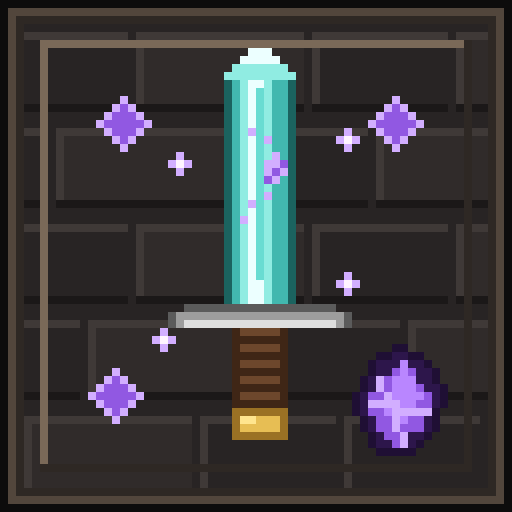

# Equipment Affix / 装备词条

**Author: yunzhihai**



A Minecraft 1.20.1 **NeoForge** mod that adds a Diablo/Primordial-style affix layer on top of vanilla equipment. Enchanting is untouched: affixes are an additional, independent layer.

## Requirements

- Minecraft 1.20.1
- NeoForge 47.1.106+ (the build uses `net.neoforged:forge:1.20.1-47.1.106`)
- Java 17

## What it adds

- **Affix Upgrade Table** (`equipment_affix:upgrade_table`) — initializes, levels and breaks through affixes.
- **Affix Reforge Table** (`equipment_affix:reset_table`, 词条重赋台) — rerolls affix types and tier distribution while keeping the item's level, rarity and total tier power.
- **17 affixes** for melee weapons, ranged weapons, tools and armor.
- **Loot generation**: naturally generated equipment can roll affixes with rarity-based affix counts.
- **Crafted gear**: equipment crafted by a player receives 3 tier-1 affixes automatically.
- **Creative testing**: affixable items in a creative player's inventory receive 3 tier-1 affixes automatically (configurable).
- **JEI integration**: item info pages for the tables, catalysts, and affix ranges.
- **Vanilla-styled** blocks, GUI and pixel-art textures; no mixins.

## Affixes

Values are percentage points unless marked *flat*.

| Id | 中文 | Category | Effect | T1 | T2 | T3 | T4 | T5 |
|---|---|---|---|---|---|---|---|---|
| `attack_damage` | 锋锐 | melee | attack damage % | 4–6 | 7–9 | 10–13 | 14–18 | 19–24 |
| `crit_chance` | 致命 | melee, ranged | crit chance % | 3–5 | 6–8 | 9–12 | 13–16 | 17–20 |
| `crit_damage` | 破势 | melee, ranged | crit damage % | 8–12 | 13–18 | 19–25 | 26–34 | 35–45 |
| `attack_speed` | 迅捷 | melee | attack interval reduction % | 3–4 | 5–7 | 8–10 | 11–14 | 15–18 |
| `reach` | 延展 | melee | attack reach % | 3–5 | 6–8 | 9–12 | 13–16 | 17–20 |
| `knockback` | 冲击 | melee | knockback distance % | 8–12 | 13–18 | 19–25 | 26–34 | 35–45 |
| `projectile_damage` | 精准 | ranged | projectile damage % | 5–7 | 8–11 | 12–16 | 17–22 | 23–30 |
| `projectile_speed` | 疾风 | ranged | projectile speed % | 5–8 | 9–13 | 14–19 | 20–26 | 27–35 |
| `mining_speed` | 采掘 | tools | mining speed % | 6–9 | 10–14 | 15–20 | 21–27 | 28–35 |
| `xp_bonus` | 识途 | tools | experience % | 5–8 | 9–13 | 14–19 | 20–26 | 27–35 |
| `luck` | 幸运 | tools | luck *flat* | 1–2 | 3–4 | 5–6 | 7–8 | 9–10 |
| `max_health` | 活力 | armor | max health *flat* | 2–3 | 4–5 | 6–8 | 9–11 | 12–15 |
| `armor` | 坚壁 | armor | armor *flat* | 1–2 | 3–4 | 5–6 | 7–8 | 9–10 |
| `armor_toughness` | 稳固 | armor | armor toughness *flat* | 1 | 1–2 | 2–3 | 3–4 | 4–5 |
| `knockback_resistance` | 定身 | armor | knockback resistance % | 3–5 | 6–8 | 9–12 | 13–16 | 17–20 |
| `movement_speed` | 轻盈 | armor | movement speed % | 2–3 | 4–5 | 6–7 | 8–9 | 10–12 |
| `damage_reduction` | 守护 | armor | incoming damage reduction % (cap 60%) | 2–3 | 4–5 | 6–8 | 9–11 | 12–15 |

### Combat rules

- Affixes stack with vanilla enchantments.
- Crit chance is rolled per melee hit; a successful roll forces a critical and scales it with crit damage. Vanilla criticals also receive the crit-damage bonus.
- Ranged weapons store their projectile affixes on the arrow when it spawns, then apply them on impact; crit particles and sound are shown.
- Armor damage reduction is applied to the player and capped at 60%.
- Attack speed is converted to an equivalent interval reduction: `attackSpeedBonus = 1 / (1 - r) - 1`.

## Progression

- Equipment starts at affix level 0; maximum is 20.
- Each normal upgrade adds one level.
- At levels **3, 7, 11, 15 and 19**, the next upgrade is a **breakthrough**: it adds a level and upgrades one random affix by one tier (maximum tier 5), rerolling its value.
- XP cost follows `ceil(6 * 1.14^level)` levels (level 0 costs 7; level 19 costs 73).
- Normal upgrades use **1 amethyst shard**. Breakthroughs use, in order: **8 amethyst shards, 1 diamond, 1 netherite scrap, 1 echo shard, 1 nether star**.
- Un-affixed equipment can be initialized in the upgrade table for **3 XP levels + 1 amethyst shard**, producing 3 tier-1 affixes.
- The **Reforge Table** costs **12 XP levels + 1 echo shard**. It keeps level, rarity, affix count and total tier sum, but rerolls affix types and tier distribution.
- The upgrade table has a **One-key upgrade** checkbox. With enough amethyst shards and XP levels, one click upgrades through all normal levels and stops right before the next breakthrough; breakthroughs are still performed manually.

### Rarity

| Rarity | Weight | Affixes | Tier range |
|---|---|---|---|
| Common | 55 | 3 | 1 |
| Uncommon | 28 | 3 | 1–2 |
| Rare | 13 | 4 | 2 |
| Epic | 4 | 4 | 2–3 |

Loot luck from the killer shifts weight toward rare/epic.

## Crafting

- **Upgrade Table**: 8 amethyst shards around a smithing table (`AAA / ASA / AAA`).
- **Reforge Table**: 4 diamonds + 4 echo shards around a smithing table (`DED / ESE / DED`).

## Compatibility

Affixability is resolved in this order:

1. Item tags under `equipment_affix:affixable/{melee,ranged,tools,armor}`.
2. Class fallback for common vanilla/modded base classes: `SwordItem`, `AxeItem`, `TridentItem`, `BowItem`, `CrossbowItem`, `ProjectileWeaponItem`, `PickaxeItem`, `ShovelItem`, `HoeItem`, `ShearsItem`, `DiggerItem`, `ArmorItem`, `ElytraItem`.

To support a modded item, add it to the matching tag (data pack or KubeJS-style tag injection), or make it extend one of the classes above. Items can be excluded through the server config blacklist.

The blacklist is a server config list of item ids; tags are the recommended compatibility path because they are data-driven and modpack-friendly.

## Configuration

`config/equipment_affix-server.toml`:

- `lootChance` (default `0.45`) — per-item chance for generated equipment to receive affixes.
- `autoDetectCrafted` (default `true`) — automatically affix player-crafted equipment.
- `affixCreativeItems` (default `true`) — automatically affix affixable creative-inventory items.
- `blacklist` (default empty) — item ids that must never receive affixes.

## JEI

JEI is optional (`mods.toml` declares it as a non-mandatory dependency). When JEI is installed, item info pages explain:

- the upgrade table and its exact XP/material cost per level and breakthrough order,
- the Reforge Table and its echo-shard cost,
- every catalyst with the exact breakthrough / reforge use (amethyst, diamond, netherite scrap, echo shard, nether star, smithing table),
- every affixable item's affix pool with tier-1–tier-5 value ranges.

The plugin lives in `src/main/java/com/equipmentaffix/compat/jei/`.

## Advancements

The mod adds a small advancement tree under **Path of Affixes**:

- obtain an upgrade table;
- give an item its first affixes;
- upgrade an item to level 1;
- complete a breakthrough;
- reforge affixes once;
- reach level 20.

They use custom code-awarded criteria, so they work in single-player and on servers without extra commands.

## NBT format

Affixes are stored in a single compound on the item stack:

```snbt
EquipmentAffix: {
  Level: 0,
  Rarity: "common",
  Affixes: [
    {Id: "attack_damage", Tier: 1, Value: 5.2d}
  ]
}
```

Only `Input` and `Material` are persisted in the table block entity; the result preview is always derived, which prevents result-slot duplication.

## Building

From the repository root:

```bash
./gradlew build
```

The remapped jar is written to `build/libs/equipment_affix-1.0.0.jar`.

The build uses ForgeGradle 6.0.54 against the NeoForge userdev artifact and the BMCLAPI mirror for the NeoForge maven, because `maven.neoforged.net` may be unreachable from some networks. `libraries.minecraft.net` is used for Mojang libraries to avoid signed CDN redirects.

For quick dev smoke tests:

```bash
./gradlew runServer --args="--nogui"   # uses run/
./gradlew runClient                    # uses run-client/
```

(You need `run/eula.txt` containing `eula=true` for the server. Client and server use separate directories so their logs/configs do not collide.)

## Project layout

```
src/main/java/com/equipmentaffix/
  affix/       AffixType, Affix, AffixData, AffixRoller, Costs, Rarity, AffixCategory
  block/       AffixTableBlock, AffixTableBlockEntity, TableKind
  menu/        AffixTableMenu
  event/       CombatEvents
  advancement/ ModAdvancements
  loot/        AffixLootModifier
  client/      AffixTableScreen, ClientSetup
  compat/jei/  AffixJeiPlugin (optional, loaded only when JEI is present)
  registry/    ModBlocks, ModItems, ModBlockEntities, ModMenus, ModCreativeTabs, ModLootModifiers
  Config.java, EquipmentAffixMod.java
src/main/resources/
  assets/equipment_affix/    block textures, GUI textures, models, blockstates, lang
  data/equipment_affix/      tags, recipes, block loot tables, loot modifier JSON
  data/forge/loot_modifiers/ global loot modifier registration
  META-INF/mods.toml, pack.mcmeta
```

## License

MIT.
